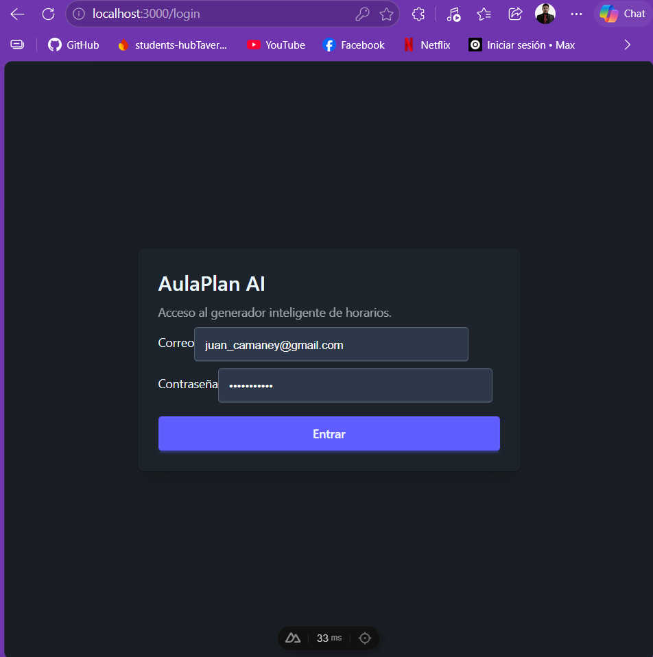
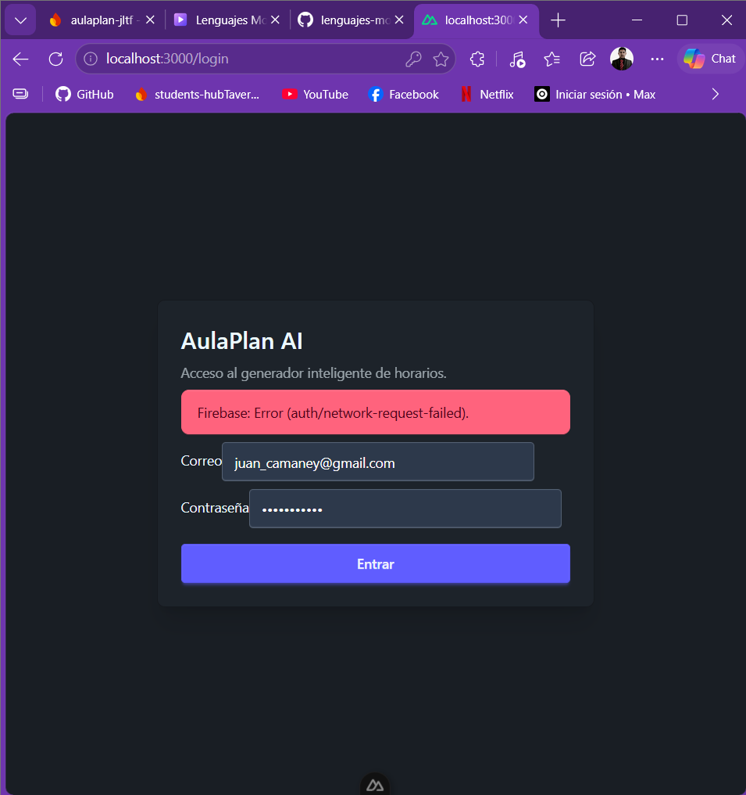

# NodeJS -  28 septiembre 2026
## Lenguajes Modernos
### Proyecto "aulaplan-jltf"
#### Juan Leonid Tavera Flores (146549)
##### Evidencia 1

## Creaciones, comandos y codigos


---
login
---




---
intento de login 
---




---
codigo routes_health.py
---

``` py

from flask import Flask
from src.http.routes_health import health_bp

def test_health():
    app = create_app(testing=True)
    client = app.test_client()
    response = client.get('/health')
    assert response.status_code == 200
    assert response.get_json()['runtime'] == 'python'
```

---
codigo dev.py
---

``` py 
from src.http.app import create_app

app = create_app()

if __name__ == '__main__':
    app.run(debug=True, port=8000)
```